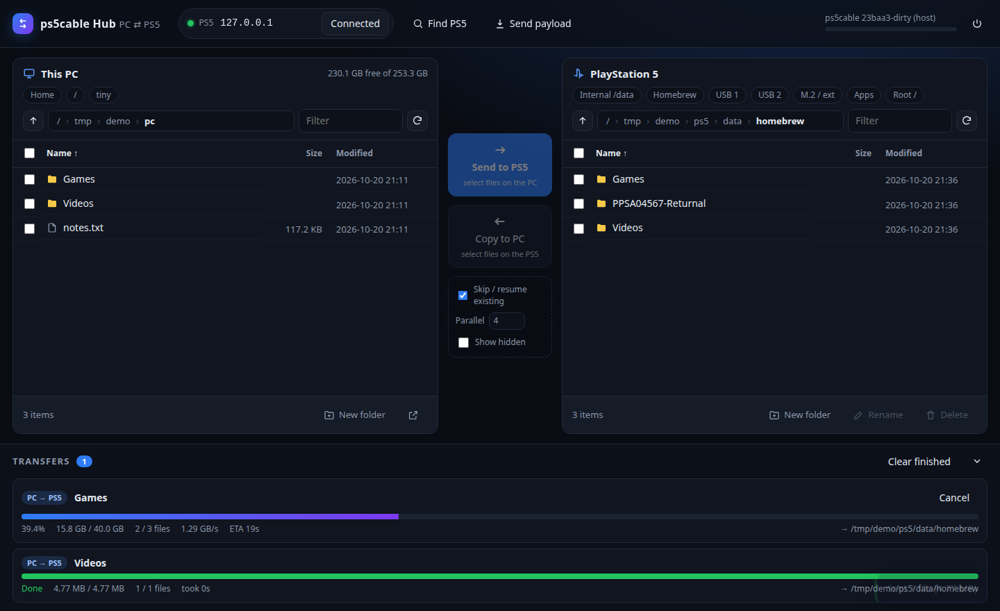

# ps5cable

Wired file transfer between a PC and a jailbroken PS5. It has three parts:

- **`payload/ps5cable.elf`**: a small file server that runs on the PS5. You send it to your jailbreak's ELF loader.
- **ps5cable Hub** (`ps5cable-hub.exe`, or `pc/hub.py`): a desktop file hub with your PC's files on one side and the PS5's on the other. You pick what to send and watch it transfer.
- **`pc/ps5cable.py`**: the same features as a command-line tool for Windows, macOS, and Linux. It needs only Python 3.8 or newer and has no dependencies.



The two talk over a direct cable from the PC to the PS5, with no router or Wi-Fi involved. On a gigabit link that runs at about 110 MiB/s, which is about 50 GB in 8 minutes.

## Why Ethernet and not a USB-C cable

Every USB port on the PS5 (front USB-C, front and back USB-A) is a **USB host** port. Your PC's USB ports are hosts too. Two hosts connected by a plain USB-C cable don't exchange data: USB needs one host and one device, and the PS5 hardware can't act as a device the way a phone can.

The usual workarounds don't apply either:

- **USB host-to-host "bridge" cables** (Prolific PL27A1 and similar) show up as a network adapter, and they need a driver on *both* sides. The PS5 kernel has none, and the jailbreak doesn't add one.
- **USB-to-Ethernet dongles plugged into the PS5** have the same driver problem.

What does work is the PS5's own gigabit Ethernet port. If your PC has no Ethernet port, use a **USB-C to Ethernet adapter on the PC side**. That gives you the "one cable out of the PC's USB-C port" setup:

```
PC USB-C ──[USB-C→Gigabit Ethernet adapter]──[Cat5e/Cat6 cable]── PS5 LAN port
```

Any straight-through Cat5e or Cat6 cable works. Both ends auto-detect, so you don't need a crossover cable. Any gigabit adapter works too (Realtek RTL8153/RTL8156, ASIX, Apple, Anker, UGREEN and so on); a 2.5 GbE adapter is fine but the PS5 caps the link at 1 Gb/s.

## Setup (one time)

### 1. PC: give the cable a fixed address

**Windows.** Plug in the cable, turn the PS5 on, then in an Administrator PowerShell:

```powershell
powershell -ExecutionPolicy Bypass -File pc\setup-direct-link-windows.ps1
```

This sets the adapter to `192.168.88.1/24` with **no gateway**, so Wi-Fi keeps handling your internet. It also marks the link Private and opens UDP 9113 for auto-discovery. To undo it, add `-Revert`.

**macOS or Linux:**

```sh
sudo ./pc/setup-direct-link-unix.sh <interface>     # e.g. en7 on macOS, enp3s0 on Linux
```

### 2. PS5: static IP on the LAN cable

Go to **Settings → Network → Settings → Set Up Internet Connection → Set Up Manually → Use a LAN Cable → Manual**:

| Field           | Value           |
|-----------------|-----------------|
| IP address      | `192.168.88.2`  |
| Subnet mask     | `255.255.255.0` |
| Default gateway | `192.168.88.1`  |
| Primary DNS     | `192.168.88.1`  |

The PS5 will say there's no internet, which is expected. Switch it back to Wi-Fi later if you want PSN.

Check the link from the PC with `ping 192.168.88.2`.

### 3. Get the app

Download **`ps5cable-windows`** from the GitHub Actions artifacts or from a release. It contains `ps5cable-hub.exe` (the desktop app, with the payload built in), `ps5cable.exe` (the command line), and `ps5cable.elf`. You can also build everything yourself, as described in Building below.

## Using ps5cable Hub (the desktop app)

1. Run your jailbreak as usual, so the ELF loader is listening on port **9021**.
2. Double-click **`ps5cable-hub.exe`**. To run from source instead, use `pc\start-hub.bat`, or `python pc/hub.py` on macOS or Linux. It opens in its own window.
3. Click **Send payload** in the top bar. The PS5 shows *"ps5cable ready on 192.168.88.2:9113"* and the dot next to the IP turns green. If you used a different IP, type it in and click **Connect**, or click **Find PS5**.
4. Pick what to send:
   - The **left pane is your PC**. Use the shortcut chips for Home, Desktop, Downloads and each drive letter, double-click folders to open them, and tick the files and folders you want. Shift-click selects a range, and Ctrl-click adds single items.
   - The **right pane is the PS5**. Its shortcut chips go to `/data`, `/data/homebrew`, USB drives and M.2 storage. Open the folder you want to copy into.
   - Click **Send to PS5 →**, or just drag the selection from the left pane onto the right one.
5. The **Transfers** panel shows each job's progress, speed and ETA, with a Cancel button. Folders are copied with everything inside.

Going the other way works the same way: select files on the PS5 side and click **← Copy to PC**, and they land in the folder open on the left. The PS5 pane can also create folders, rename, and delete (with confirmation).

**Skip / resume existing** is on by default. Files already complete on the destination are skipped, and partly copied ones continue from where they stopped, so re-running a cancelled or interrupted transfer only sends what's missing. **Parallel** sets the number of connections (default 4). The app remembers the PS5 IP and the last folder on each side.

About security: the app listens only on `127.0.0.1`, and every request needs a random token created at launch, so other devices and websites can't use it. Closing the window shuts the app down after a few minutes. It stays open while transfers are running, and the ⏻ button quits immediately.

## Using the command line

1. Send the payload over the cable:

   ```sh
   python pc/ps5cable.py send-payload payload/ps5cable.elf
   ```

   If a copy is already running, sending again replaces it. If you'd rather load it with a payload manager or autoloader, put `ps5cable.elf` wherever that tool expects payloads.

2. Transfer files:

   ```sh
   # upload a folder (recursive), 4 parallel connections
   python pc/ps5cable.py put "D:\Games\PPSA01234" /data/homebrew

   # an interrupted upload continues where it stopped; finished files are skipped
   python pc/ps5cable.py put --resume "D:\Games\PPSA01234" /data/homebrew

   # download from the PS5
   python pc/ps5cable.py get /data/homebrew/PPSA01234 D:\Backup

   # browse and manage files
   python pc/ps5cable.py ls /data
   python pc/ps5cable.py df /data
   python pc/ps5cable.py mkdir /data/homebrew/new
   python pc/ps5cable.py mv /data/a.bin /data/b.bin
   python pc/ps5cable.py rm -r /data/homebrew/old

   python pc/ps5cable.py discover   # find the console
   python pc/ps5cable.py shutdown   # stop the payload
   ```

The PS5's address is resolved in this order: `--host`, then the `PS5_HOST` environment variable, then auto-discovery (a UDP broadcast), then `192.168.88.2`.

Useful places on the PS5: `/data` is internal storage that your File Manager can see, `/mnt/usb0` is the first USB drive, and `/mnt/ext0` is M.2 or extended storage.

## Performance notes

- One large file fills the gigabit link by itself. `-j` (default 4) matters for folders with thousands of small files, where per-file round trips would otherwise dominate.
- On loopback the server and client together move about 1 GB/s, so the cable is the only bottleneck.
- Uploads are written in place. If the transfer is interrupted, `--resume` checks each file's size on the PS5 and sends only what's missing.

## Building

The payload uses [ps5-payload-dev/sdk](https://github.com/ps5-payload-dev/sdk). v0.44 or newer is needed for firmware 13.60 kernel offsets.

```sh
sudo apt-get install clang-18 lld-18 llvm-18          # Debian/Ubuntu or WSL
wget https://github.com/ps5-payload-dev/sdk/releases/download/v0.44/ps5-payload-sdk.zip
sudo unzip -d /opt ps5-payload-sdk.zip
export PS5_PAYLOAD_SDK=/opt/ps5-payload-sdk

make -C payload                                       # -> payload/ps5cable.elf
make -C payload deploy PS5_HOST=192.168.88.2          # build and send to the ELF loader
```

`make -C payload host` builds the same server for your PC. The end-to-end tests and the Hub tests use that build:

```sh
python3 -m unittest discover -s tests -v
```

To build the Windows executables (CI does the same on `windows-latest`), run this on Windows with `ps5cable.elf` in `payload/`:

```sh
pip install pyinstaller
pyinstaller --onefile --noconsole --name ps5cable-hub --paths pc --add-data "pc/hub_ui.html;." --add-data "payload/ps5cable.elf;." pc/hub.py
pyinstaller --onefile --console --name ps5cable pc/ps5cable.py
```

## Troubleshooting

- **`ping 192.168.88.2` fails.** Check that the adapter's link light is on and that the PS5 network settings are saved on *LAN cable*, not Wi-Fi. On Windows, run `ipconfig` and confirm the adapter shows `192.168.88.1`.
- **`send-payload` can't connect to port 9021.** The jailbreak's ELF loader isn't running, or it's using a different port. Pass `--loader-port`.
- **`discover` finds nothing, but `--host 192.168.88.2 ping` works.** The firewall is dropping the broadcast reply. Run the Windows setup script, or just use `--host` or `PS5_HOST`.
- **Logs.** The payload writes to the PS5 kernel log. If you run a klog server payload, `nc 192.168.88.2 3232` shows them.

## Protocol

There is one TCP port (9113), and each request and response has a fixed 24-byte header, followed by raw file bytes for uploads and downloads. The format is documented in [`payload/proto.h`](payload/proto.h). Discovery is a UDP `P5CX?` message to port 9113, which the payload answers with `P5CX! <port> <version>`.

## Credits

The payload approach follows John Törnblom's [ftpsrv](https://github.com/ps5-payload-dev/ftpsrv) and the [ps5-payload-sdk](https://github.com/ps5-payload-dev/sdk). The direct-cable setup was suggested by [ps5upload](https://github.com/phantomptr/ps5upload)'s FAQ. Licensed under GPL-3.0-or-later, matching the SDK.
